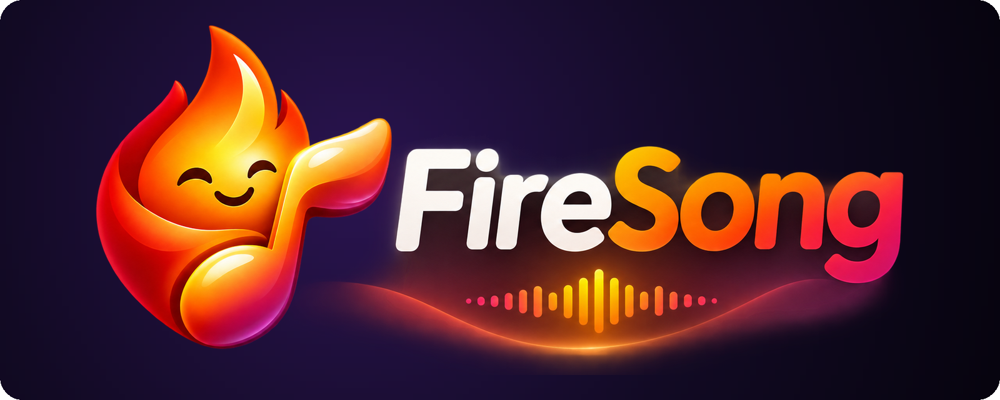

<p align="center">
  
</p>

<p align="center">
  <strong>Korean-style noraebang karaoke for Fire TV: your own music library, phones as wireless mics, cheesy background videos, and a score at the end.</strong>
</p>

<p align="center">
  <a href="#install">Install</a> ·
  <a href="#what-works">What works</a> ·
  <a href="#how-it-works">How it works</a> ·
  <a href="#build-from-source">Build</a> ·
  <a href="#credits">Credits</a>
</p>

<p align="center">
  
  
  
  
</p>

---

## Why

A night at a Korean noraebang goes like this: a room, up to four mics, a
song book with everything in it, a ridiculous stock-footage video behind the
lyrics, an echo that makes everyone sound better than they are, and a score
with a drum roll when the song ends. Home karaoke apps on Fire TV give you a
subscription catalog, one mic and none of the fun.

FireSong builds that room at home. Songs come from the music library you
already have in Plex. The guests' phones are the microphones. The Fire TV
does the rest.

```
  Phones (Safari)                       Fire TV (FireSong TV app)
  ---------------                       -------------------------
  Scan QR   --  pairing + signaling -->  slot 1-4, one colour each
  Mic page  --  WebRTC Opus voice   -->  gate, compressor, noraebang echo  -->  TV speakers
                (peer to peer, Wi-Fi)    pitch scoring per singer          -->  0-100 score reveal

  Self-hosted server                    Fire TV
  ------------------                    -------
  Plex library  --  stems + lyrics  -->  synced wipe lyrics over random clips
```

## Install

FireSong has three parts: a self-hosted server on a Linux box at home, the
TV app on a Fire TV, and a web page that guests open on their phones. There
is no release APK yet; for now everything is built from source (see
[Build from source](#build-from-source)).

### 1. Server

The server is [Nightingale](https://github.com/rzru/nightingale)'s
self-hosted server with FireSong's additions. It runs as a systemd user
service with two loopback listeners: one for the TV and one for phones. An
NVIDIA GPU is optional; song preparation falls back to the CPU and is just
slower. The full runbook, including the song cache and GPU sharing, is in
[`docs/firesong/DEPLOY.md`](docs/firesong/DEPLOY.md).

To connect Plex, open FireSong on the server once with the host link and
choose **Connect Plex → Sign in with Plex**. Plex shows an approval page
that you can open on your phone from anywhere; approve it, then pick the
server and the music library. FireSong becomes its own Plex device, so you
can revoke it on its own.

### 2. TV app

```bash
adb connect <fire-tv-ip>:5555
adb install app-release.apk
```

The TV app is a thin WebView host for the FireSong page, with the Fire TV
remote mapped to the karaoke controls. Build it from
`android/firesong-tv/` (see below). A Downloader short link, like
[FirePlay](https://github.com/jimnoneill/FirePlay)'s, is planned with the
first release.

### 3. Phones

Phones need HTTPS to use the microphone. For a party, switch on the phone
door (Tailscale Funnel on port 8443; one command, see DEPLOY.md), then each
singer scans their colour's QR code on the TV, opens it in Safari and taps
Allow. Switch the door off when the party ends.

## What works

FireSong v1 is built and passes its automated tests end to end: the real
server, the TV page and two simulated phones singing 440 Hz and 330 Hz in
headless Chrome, each pitch reading within ±3 Hz. The TV app installs and
loads on a Fire TV Cube 3rd gen (AFTGAZL, Fire OS 7.7.1). The next step is
real iPhones in a real room.

## Status

| Piece | State |
|---|---|
| Plex library, stem separation, word-timed lyrics (Nightingale) | works |
| Phone mic page and WebRTC voice to the TV | works in automated end-to-end tests |
| TV voice engine: gate, compressor, noraebang echo, reverb, limiter | works in automated browser tests |
| Pitch scoring per phone singer, up to four | works in automated end-to-end tests |
| Noraebang mode: random clips, wipe lyrics, 0-100 score reveal | built and unit-tested; first TV run next |
| Fire TV app: install, load, remote keys, HOME and app switching | installs and loads on a Fire TV Cube; lifecycle covered by unit tests |
| Phone access over Tailscale Funnel, party-only | documented |
| Mouth-to-speaker latency with real iPhones | not measured yet: next |
| Release APK and Downloader short link | planned |

## How it works

The karaoke engine is [Nightingale](https://github.com/rzru/nightingale).
It reads the Plex library, separates the vocals, finds or transcribes
word-timed lyrics, and scores pitch for up to four players. FireSong keeps
that engine and adds what a noraebang needs around it. FireSong code lives in
its own files, and upstream files get only thin hooks, so the fork keeps
rebasing onto new Nightingale releases.

**Phones as mics.** Each of the four slots has its own QR code and colour.
The phone page captures the singer's voice and sends it peer to peer over
the home Wi-Fi to the TV as WebRTC Opus with 10 ms packets and no extra
jitter buffering. The server only relays pairing and signaling, so voices
never leave the house.

**The TV voice engine.** On the Fire TV, one long-lived Web Audio graph owns
the phone streams. Each slot gets a high-pass filter, a gate, a compressor
and a fader. A shared bus adds the noraebang echo, whose delay is locked to
each phone's measured latency so the delay sounds like part of the effect,
plus reverb and a limiter. Each slot also feeds Nightingale's pitch scoring as
an ordinary microphone, so every singer gets their own score.

**Noraebang mode.** Random cheesy background clips, a two-line lyric bar
that fills in word by word, the live score hidden while you sing, and a
0-100 score reveal with a synthesized drum roll and fanfare.

**The TV app.** A small Kotlin WebView host, reused from FirePlay's Fire TV
skeleton. It loads the FireSong page over LAN HTTPS with a pinned local CA,
maps the remote's keys, recovers from crashes and network loss, and stops
all audio when you press HOME.

**Two doors.** The server listens on two loopback ports: the TV door with
everything, protected by a host token, and the phone door with only the mic
page, the song queue and signaling. Only the phone door is ever published,
and only during a party.

The shared contract (listeners, auth, every signaling message, the slot
rules) is in [`docs/firesong/PROTOCOL.md`](docs/firesong/PROTOCOL.md), and a
map of the code is in
[`docs/firesong/README-FIRESONG.md`](docs/firesong/README-FIRESONG.md).

## Build from source

You need Node 22.12 or newer with corepack, Rust (the version pinned in `rust-toolchain.toml`, installed by rustup), JDK 17 and an Android SDK
with `platforms;android-34`. On Linux:

```bash
git clone https://github.com/jimnoneill/FireSong
cd FireSong

# Web client (embedded into the server binary)
(cd client && pnpm install --frozen-lockfile && pnpm build)

# Server
cargo build --release --locked -p server

# Fire TV app
cd android/firesong-tv
./gradlew assembleDebug
adb install app/build/outputs/apk/debug/app-debug.apk
```

`scripts/firesong/build-release.sh` does the whole release build, and
[`docs/firesong/README-FIRESONG.md`](docs/firesong/README-FIRESONG.md) lists
every check: unit tests, headless browser tests, the end-to-end run, and
the Fire TV app tests.

The Fire TV app targets Android 9 (Fire OS 7) and newer, so any recent
Fire TV or Android TV should run it.

## Credits

This project stands on top of other people's work:

- [rzru/nightingale](https://github.com/rzru/nightingale), the karaoke
  engine FireSong is forked from: library sources, song analysis, lyrics,
  pitch scoring, the React client and the self-hosted server
  (GPL-3.0-or-later).
- Nightingale's analyzer uses [Demucs](https://github.com/facebookresearch/demucs)
  and UVR models through
  [audio-separator](https://github.com/nomadkaraoke/python-audio-separator)
  for vocal separation, [WhisperX](https://github.com/m-bain/whisperX),
  NVIDIA Parakeet and Qwen3-ASR for transcription and alignment, and
  [LRCLIB](https://lrclib.net) for synced lyrics.
- [pitchy](https://github.com/ianprime0509/pitchy), pitch detection in the
  browser.
- [jimnoneill/FirePlay](https://github.com/jimnoneill/FirePlay), the Fire
  TV app skeleton.
- Background clips come from the Internet Archive's Prelinger collection
  (public domain or CC0 only) and, with your own API keys, from
  [Pixabay](https://pixabay.com) and [Pexels](https://www.pexels.com), each
  kept with a licence record.

## Legal posture

I'm not a lawyer and this is not legal advice. It's a description of what
this project does and doesn't do.

FireSong ships no music, no lyrics and no videos. Songs come from the
user's own Plex library. Lyrics come from LRCLIB or are transcribed locally
from the user's own files. Background clips are fetched only when they are
public domain, CC0, or under the Pixabay or Pexels licences, and each one
keeps a record of its source and licence. Voices go from the phones to the
TV inside the home network and are not recorded.

FireSong is not affiliated with Amazon, Plex or any karaoke company.
"Fire TV" and "Plex" appear here as descriptive names for the platforms it
runs on and reads from.

## Support

If FireSong made your living room a noraebang, contributions toward keeping
it maintained are welcome.

<p align="center">
  <a href="https://paypal.me/jimnoneill"></a>
</p>

The engine underneath is Nightingale; consider supporting it on
[Patreon](https://www.patreon.com/cw/nightingalekaraoke) or
[Ko-fi](https://ko-fi.com/nightingalekaraoke) as well.

## License

GPL-3.0-or-later, inherited from Nightingale. See [LICENSE](LICENSE).
