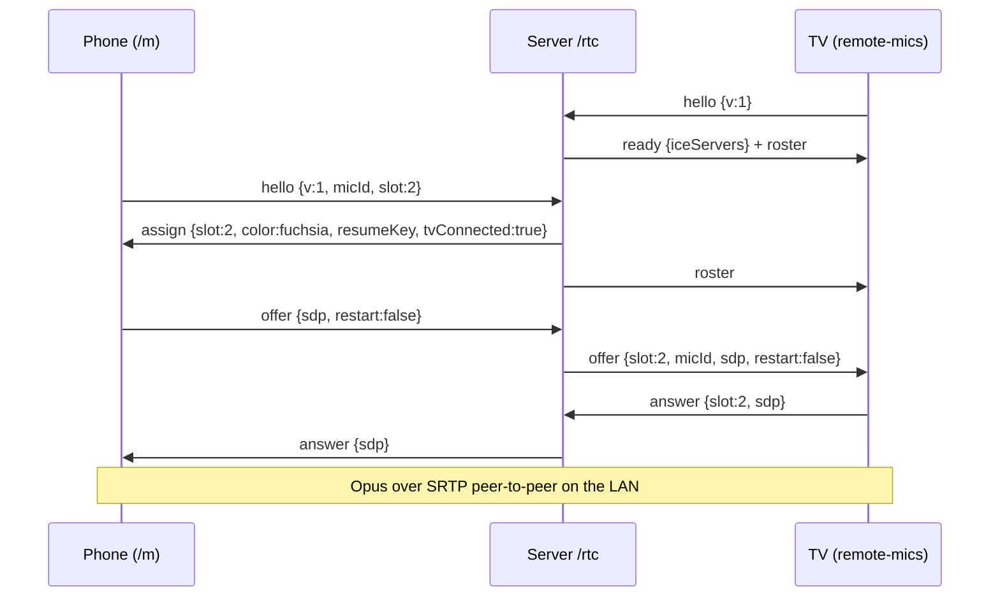
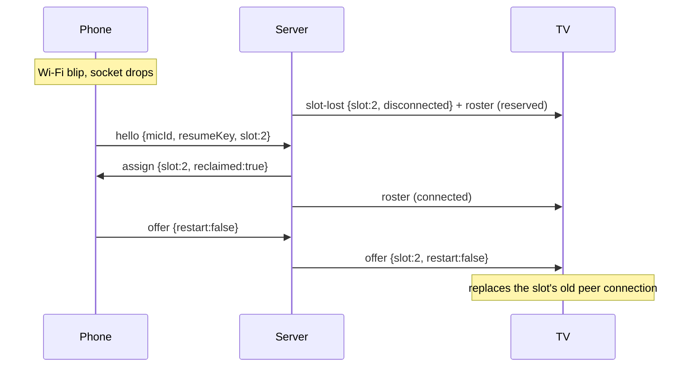
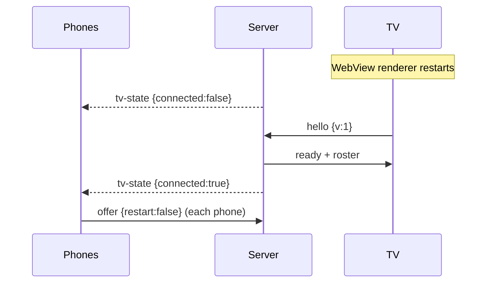

# FireSong phone-mic contract

This is the shared contract between the FireSong work packages that run in parallel: the server, the TV voice engine, the phone page, the Fire TV app and the deploy tooling. It covers:

- the two HTTP listeners and their authentication;
- the environment variables;
- the `/rtc` signaling socket and its messages;
- the slot registry;
- the WebRTC session rules;
- how phone microphones appear to the client's `MicrophoneAdapter`.

**Sources of truth.** If this page and the code disagree, the code wins, and the page gets fixed.

| What | Where |
|---|---|
| Wire types, limits, close codes, slot colours, frame validation | `app-core/src/remote_mic.rs` (Rust, with tests) |
| Generated TypeScript wire types | `client/src/types/firesong/*.ts` (ts-rs output; never edit by hand) |
| Client re-exports, constants, device-id helpers, zod validators | `client/src/features/remote-mic/protocol.ts` |

`protocol.ts` carries a compile-time check, `ProtocolSchemasMatchRust`: `pnpm typecheck` fails if the zod validators and the generated types differ by a variant, a field, or optionality.

Placeholders such as `<phone-origin>` and `<cube-ip>` stand for host-specific values. Those values live in git-ignored env files (`scripts/firesong/devenv.local.sh`, `deploy/server/*.env`), never in the repository.

---

## 1. Surfaces

There is one server process with two listeners:

| Listener | Env var | Router | Who | Auth | Reached through |
|---|---|---|---|---|---|
| Full ("TV door") | `NIGHTINGALE_BIND` | upstream `router()` + `/rtc` (role **tv**) + `GET /api/firesong/mic-links` | Fire TV app, the operator's browser, a laptop stand-in TV | **Host token** (§2.2) | Caddy `tls internal` on the LAN, or `tailscale serve` (tailnet only) for the travel rig |
| Remote ("phone door") | `NIGHTINGALE_REMOTE_BIND` (new) | upstream `remote_router()` + `/rtc` (role **mic**); the `/m` page comes from the static fallback | Guests' phones | **Pairing token** (§2.1) | Tailscale Funnel `:8443`, only during parties |

Rules:
- The listener decides the role. A socket on the remote listener can only ever be a phone, so a phone cannot act as the TV.
- Without `NIGHTINGALE_REMOTE_BIND` there is no phone listener. That is upstream behaviour.
- `NIGHTINGALE_REMOTE_BIND` must differ from `NIGHTINGALE_BIND`. Startup fails if the two are the same.
- Both binds are loopback on the server machine (`127.0.0.1:64448` full, `127.0.0.1:64449` remote). Only the proxies are exposed.
- Funnel maps **only** the remote listener. The full listener is never published to the internet.
- The `/q` queue page and its `REMOTE_COMMANDS` allowlist (`client/src-server/src/remote.rs`) are unchanged. `/m` uses no `/api/cmd` command; it talks only over `/rtc`.

New HTTP routes:

| Route | Listener | Response |
|---|---|---|
| `GET /rtc` (WebSocket upgrade) | both | §4 onwards |
| `GET /m?t=<pairing token>&slot=<1-4>` | remote | the SPA's `index.html` through the static fallback. `require_token` turns `?t=` into the pairing cookie. |
| `GET /api/firesong/mic-links` | full | `MicLinks` JSON (§3.1) |

### 1.1 Mic links

`GET /api/firesong/mic-links` returns `{ "slots": MicLink[4] }`. Slots 1-4 are listed in order, and each entry is `{ slot, color, url, qrSvg }`:
- `url` is `<base>/m?t=<pairing token>&slot=<n>`. `<base>` is chosen the same way as for `/api/remote`, so `NIGHTINGALE_REMOTE_URL` wins when it is set.
- `url` and `qrSvg` are `null` when the server knows no base that a phone can reach.
- The QR comes from the same SVG builder as `/api/remote` (`RemoteControl::info_with_url`).
- The TV idle screen shows the four codes, each in its slot colour.

## 2. Authentication

### 2.1 Pairing token (phones; upstream, unchanged)

- The token is stored in `<data>/remote-control.json` and is 32 lowercase hex characters.
- A phone can present it three ways: the cookie `nightingale_remote`, the header `x-nightingale-token`, or the query `?t=`. A valid `?t=` sets the cookie (`Path=/; HttpOnly; SameSite=Lax`).
- QR links are `…/m?t=<token>&slot=N`. The phone must stay in a **Safari tab**, because a Home Screen web app has its own cookie jar and would lose the cookie.
- Rotate the token before every party.
- Test clients can open `wss://<phone-origin>/rtc?t=<token>` directly.

### 2.2 Host token (full listener; new, WP2 `client/src-server/src/host_auth.rs`)

| Item | Value |
|---|---|
| Storage | `<data>/firesong/host-token`, where `<data>` = `NIGHTINGALE_DATA_PATH`. The file holds 32 lowercase hex characters (128 random bits), mode `0600`, surrounding whitespace ignored. The server creates it atomically (temp file + rename) on first start if it is missing. To rotate, delete the file and restart. |
| Cookie | `firesong_host=<token>; Path=/; HttpOnly; SameSite=Strict`, plus `; Secure` when the request arrived over HTTPS (`x-forwarded-proto: https`) |
| Header | `x-firesong-host-token: <token>`, for tools and tests |
| Query bootstrap | `?host=<token>` on any `GET` sets the cookie. For a top-level navigation (`Accept` contains `text/html`), the server answers `303` to the same URL with `host` removed, so the token does not stay in history. |
| Comparison | constant time, the same as `remote::constant_time_eq` |
| Failure | `401`, body `host token required`, no other detail |
| Exempt paths | `/favicon.png`, `/favicon.ico`, `/apple-touch-icon.png` (the same list as the remote router) |
| Scope | Every other path on the full listener: `/api/*`, `/media/*`, `/ws`, `/rtc` and the static bundle. Loopback requests are **not** exempt, because Caddy makes every request look like loopback. |

How the Fire TV app gets the token: deploy tooling reads the file and starts the app with `am start … --es host_token <t>`. The app stores it in SharedPreferences and sets the cookie for the TV origin through `CookieManager` before `loadUrl`.

How the operator's browser gets it: open `<tv-origin>/?host=<t>` once.

Cookie notes:
- WebSocket upgrades from the same origin carry the cookie.
- `SameSite=Strict` (host) and `SameSite=Lax` (pairing) keep a cross-site page from opening `/rtc` with them (cross-site WebSocket hijacking).
- WP3 should also reject an upgrade whose `Origin` host differs from the request's `Host` (or `X-Forwarded-Host`), once it has checked what Caddy and Funnel forward.

### 2.3 Secrets

The following must never appear in logs, error frames, `/api/bootstrap` or `load_config` output:
- the host token;
- the pairing token;
- `resumeKey`;
- Plex, Jellyfin and Navidrome credentials.

The redaction of `load_config`, `/api/bootstrap` and `plex_*` is WP2's job. `save_config` keeps the stored secret when it receives the redaction marker.

Logging rules:
- SDP and ICE candidates contain LAN addresses, so they are logged only at `trace` level.
- `diag` payloads are logged only at `trace` level.

## 3. Environment variables

| Variable | Read by | Default | FireSong setting | Notes |
|---|---|---|---|---|
| `NIGHTINGALE_BIND` | server (upstream) | `0.0.0.0:8080` | `127.0.0.1:64448` | Full listener. `*:8080` and `127.0.0.1:8081` are taken on the server machine. |
| `NIGHTINGALE_REMOTE_BIND` | server (new, WP2) | unset (no phone listener) | `127.0.0.1:64449` | Phone listener. Must differ from `NIGHTINGALE_BIND`. |
| `NIGHTINGALE_REMOTE_URL` | server (upstream) | unset (LAN detection) | `<phone-origin>`, the Funnel `https://<host>.<tailnet>.ts.net:8443` | Base of every phone link (`/q` and `/m`). Pinning it means the QR is never downgraded to http. |
| `NIGHTINGALE_DATA_PATH` | app-core (upstream) | `~/.nightingale` | a **local** disk directory, e.g. `/mnt/fast/firesong/data` | Holds `config.json`, `songs.json`, profiles, the SQLite library DB, `remote-control.json`, `firesong/host-token` and `firesong/remote-mics.json`. Never point it at NFS: SQLite locking is unsafe there. |
| `config.json` → `cache_paths.songs` | app-core (upstream config) | `<data>/cache` | the song-cache mount (`FIRESONG_SONG_CACHE`) | Stems and transcripts. Deploy tooling writes this value; no code hardcodes the path. |
| `FIRESONG_SONG_CACHE` | deploy tooling only (WP1) | none | the NFS mount, e.g. `/mnt/firesong-cache` | Song prep **refuses to run** unless this path is a mounted filesystem (`mountpoint -q`). |
| `FIRESONG_SONG_CACHE_MAX_GB` | deploy tooling only (WP1) | `36` | `36` | LRU eviction of finished songs keeps the cache below this (the volume has a hard 40 GB cap). |
| `FIRESONG_CLIP_DIR` | server (WP8, `noraebang_clips.rs`) | `<data>/noraebang/clips` | default | Must be a real directory (not a symlink) inside `local_media_roots`, and outside the videos dir, whose files Pixabay eviction deletes. |
| `FIRESONG_ICE_SERVERS` | server (WP3) | `[]` | unset | JSON array of `IceServer` handed out in `assign` and `ready`. Leave empty on the LAN; add coturn only if spike S7 fails. |
| `CUDA_VISIBLE_DEVICES` | analyzer child (inherits the server's env) | all GPUs | the RTX 4090's GPU UUID, from the git-ignored env file | **Never** the RTX PRO 6000: the vendor picks cu126 wheels from the first `nvidia-smi` line, and those have no sm_120 kernels. |
| `CUDA_DEVICE_ORDER` | analyzer child | driver default | `PCI_BUS_ID` | Makes indices match `nvidia-smi`. |
| `NIGHTINGALE_LIBRARY_PATH` | server (upstream) | unset | **must stay unset** | When set, it re-pins a folder library over Plex on every start. |
| `PIXABAY_API_KEY` | server (upstream, optional) | unset | runtime only | Never a build argument. |
| `RUST_LOG` | server | `info,tower_http=info,server=info` | default | |

## 4. `/rtc` transport

- **Frames.** One JSON object per WebSocket text frame, discriminated by `"type"`. Type names are kebab-case and field names camelCase.
- **Typed per role.** The server decodes phone frames as `MicToServer` and TV frames as `TvToServer` (`decode_mic_frame` / `decode_tv_frame`). Unknown fields are ignored, which allows additive changes. Unknown types, or types belonging to the other role, give `bad-frame`.
- **Stamping.** Inbound phone frames never carry `slot` or `micId`. On frames relayed to the TV, the server stamps both from its registry, and any client-sent values are dropped.
- **Binary frames** give `bad-frame`.
- **Limits** (constants in `remote_mic.rs`): frame 64 KiB, SDP 32 KiB, candidate 1 KiB, `diag` 8 KiB of serialised JSON, name 1-32 characters with no control characters, song title 200 characters, `latencyMs` 0-1000, `displayScore` 0-100, `rawScore` 0-1000.
- **Rate limit.** Each socket has a token bucket with a burst of 40 frames, refilled at 20 frames/s. Going over gives `rate-limited` and the socket is closed.
- **Handshake.** The first frame must be `hello`. Any other frame first gives `no-hello`, and so does no `hello` within 5 s; the socket is then closed. A second `hello` gives `bad-hello`.
- **Keepalive.**
  - The server sends a WebSocket ping every 5 s and closes (4408) a socket that has received nothing, not even a pong, for 15 s.
  - Browsers cannot see WebSocket pings, so clients also send `ping {t}` every 5 s and get `pong {t}` back. A client that has had no `pong` for 10 s closes the socket and reconnects.
- **Versioning.** `hello.v` must equal `PROTOCOL_VERSION` (1), otherwise `version`.

### 4.1 Errors and close codes

An `error {code, message?}` frame is sent first. For fatal codes the server then closes the socket with the matching code.

| Code | Fatal | Close | Meaning |
|---|---|---|---|
| `bad-frame` | no | — | not JSON, an unknown or other-role `type`, or a field out of range |
| `bad-hello` | yes | 4400 | invalid `micId`, `resumeKey`, `slot` or `name`, or a second `hello` |
| `version` | yes | 4400 | `hello.v` is not 1 |
| `no-hello` | yes | 4408 | a frame before `hello`, or `hello` timed out |
| `bad-resume` | yes | 4403 | `micId` is in the registry but `resumeKey` is missing or wrong |
| `slots-full` | yes | 4503 | all four slots are held by connected phones |
| `too-large` | yes | 4413 | a frame, SDP, candidate or diag over its limit |
| `rate-limited` | yes | 4429 | the token bucket is empty |
| `tv-replaced` | yes | 4409 | a newer TV socket took the TV seat |
| `no-tv` | no | — | a phone sent `offer` while no TV is connected |
| `unknown-slot` | no | — | the TV addressed a slot with no phone (or no entry, for `kick` and `latency`) |

Other closes:
- 4409 after `slot-lost {replaced}`;
- 4410 after `slot-lost {kicked}`;
- 1000 after `bye`.

**Client reconnect policy** (phone and TV):
- Back off 0.5, 1, 2, 4, then 8 s (the cap), each ±20 % jitter. Reset the backoff after 30 s connected.
- **No automatic reconnect after 4409 or 4410** (`NO_RECONNECT_CLOSE_CODES`). The phone shows "joined from another tab" or "removed by host", with a manual Rejoin button.
- After 4400, stop and show the error; it is a bug.
- After 4403, the phone drops its stored identity, makes a new `micId`, and reconnects once at once.
- After 4503, retry every 5 s while showing "all 4 mics are in use".

## 5. Messages

All messages are generated as TypeScript from the Rust enums. Optional fields (`?`) are omitted when absent; inbound frames may also send them as `null`. `IceCandidate` is `{candidate, sdpMid?, sdpMLineIndex?, usernameFragment?}`, the browser's `RTCIceCandidateInit` (`candidate.toJSON()`), whose optional fields may be `null`.

### 5.1 Phone → server (`MicToServer`)

| `type` | Fields | Notes |
|---|---|---|
| `hello` | `v: 1`, `micId`, `resumeKey?`, `slot?: 1-4`, `name?` | Must be first. `micId`: 8-64 characters of `[A-Za-z0-9_-]`, made once by the phone (`crypto.randomUUID()`) and kept in localStorage. `slot` is a preference: the QR's `slot`, or the slot from the last `assign`. `resumeKey` comes from the last `assign`. |
| `offer` | `sdp`, `restart: boolean` | The phone is always the offerer. `restart: true` means an ICE restart of the current session. |
| `ice` | `candidate: IceCandidate \| null` | Optional trickle. `null` means end-of-candidates. |
| `mute` | `muted` | The phone's own mute toggle. |
| `diag` | `data: object` | Free-form, at most 8 KiB: `track.getSettings()`, outbound-rtp stats, wake-lock state. Relayed to the TV. |
| `bye` | — | Leaving on purpose: the slot is freed at once. |
| `ping` | `t: number` | Echoed back as `pong`. |

### 5.2 Server → phone (`ServerToMic`)

| `type` | Fields | Notes |
|---|---|---|
| `assign` | `v`, `slot`, `color`, `micId`, `resumeKey`, `reclaimed`, `tvConnected`, `iceServers` | The reply to `hello`. The phone stores `{micId, resumeKey, slot}` under the localStorage key `firesong.mic` (`StoredMicIdentity`). If the slot is muted, a `mute` frame follows at once. |
| `answer` | `sdp` | Relayed from the TV. |
| `ice` | `candidate \| null` | Relayed from the TV. |
| `restart` | — | The TV asks for a new `offer {restart: true}`. |
| `mute` | `muted`, `by: 'mic' \| 'tv'` | The authoritative mute state. When `by` is `tv`, the phone shows "muted by host" and sets `track.enabled = false`. |
| `tv-state` | `connected` | Sent on every change of the TV seat. On `connected: true`, the phone discards its current peer connection and sends a fresh `offer {restart: false}`. |
| `song-result` | `displayScore` 0-100, `rawScore` 0-1000, `tier`, `rank?`, `singers?`, `title?` | This phone's own result. |
| `slot-lost` | `reason: 'replaced' \| 'kicked'` | The socket closes right after (4409 or 4410). |
| `error` | `code`, `message?` | §4.1 |
| `pong` | `t` | |

### 5.3 TV → server (`TvToServer`)

| `type` | Fields | Notes |
|---|---|---|
| `hello` | `v: 1` | Must be first. Takes the single TV seat. |
| `answer` | `slot`, `sdp` | |
| `ice` | `slot`, `candidate \| null` | |
| `restart` | `slot` | Ask that phone for an ICE-restart offer. |
| `mute` | `slot`, `muted` | Host mute. Its source is recorded as `by: 'tv'`. |
| `kick` | `slot` | Free the slot and disconnect its phone. |
| `latency` | `slot`, `latencyMs` 0-1000, `method: 'beep' \| 'stats' \| 'manual'` | Stored against the slot's `micId` and persisted (§6.4). |
| `song-result` | `title?`, `results: SlotResult[]` (at most 4) | `SlotResult = {slot, displayScore, rawScore, tier, rank?}`. Sent when the score reveal starts. |
| `ping` | `t` | |

### 5.4 Server → TV (`ServerToTv`)

| `type` | Fields | Notes |
|---|---|---|
| `ready` | `v`, `iceServers` | The reply to `hello`. A `roster` follows at once. |
| `roster` | `slots: TvSlot[4]` | A full snapshot of slots 1-4 in order, sent after `ready` and after every registry change. `TvSlot = {slot, color, state, micId?, name?, muted, latencyMs?, latencyMethod?, reservedForSecs?}`. `micId` is present unless `state` is `empty`. |
| `offer` | `slot`, `micId`, `sdp`, `restart` | Stamped by the server. |
| `ice` | `slot`, `micId`, `candidate \| null` | Stamped by the server. |
| `mute` | `slot`, `muted`, `by` | |
| `diag` | `slot`, `micId`, `data` | |
| `slot-lost` | `slot`, `micId`, `reason` | `disconnected`: the slot is now `reserved`. `bye`, `expired`, `evicted`, `kicked`: the slot is free. `replaced`: the same phone reconnected, and a fresh `offer` follows. |
| `error` | `code`, `message?` | |
| `pong` | `t` | |

### 5.5 Slots and colours

There are 4 slots. Slot N always has player colour N, so the QR, the TV badge, the multiplayer player colour and the score reveal all agree:

| Slot | `PlayerColor` |
|---|---|
| 1 | `rose` |
| 2 | `fuchsia` |
| 3 | `amber` |
| 4 | `emerald` |

The source is `slot_color()` in Rust and `slotColor()` in TS, both matching `PLAYER_COLOR_VALUES`.

### 5.6 Score tiers

`tier` is derived from `displayScore`, by `ScoreTier::for_display_score` in Rust and `scoreTierFor` in TS:

| Score | `tier` | Caption (WP8, through i18n keys) |
|---|---|---|
| 100 | `perfect` | 완벽해요! |
| 90-99 | `excellent` | 훌륭해요! |
| 80-89 | `great` | 잘했어요! |
| 70-79 | `good` | 좋아요! |
| 0-69 | `retry` | 다시 도전! |

`displayScore` is for display only. Profiles keep storing Nightingale's raw 0-1000 score.

## 6. Slot registry (server, WP3)

The registry lives in `AppState`, as one new field. It is in memory, transport-neutral, and keyed by `micId`. Each entry is:

`{ slot, micId, resumeKey, state: connected|reserved, name?, muted, mutedBy, latencyMs?, latencyMethod?, reservedUntil? }`

An `empty` slot has no entry. `resumeKey` exists only in memory and is never persisted.

### 6.1 `hello` resolution, in order

1. **Known `micId`.** If an entry with this `micId` exists:
   - **Matching `resumeKey`** (constant-time compare), so this is a reclaim:
     - If another socket holds the entry, that socket gets `slot-lost {replaced}` and is closed with 4409, and the TV gets `slot-lost {slot, micId, replaced}`.
     - The entry becomes `connected` on this socket, and `name` is updated if one was sent.
     - The phone gets `assign {reclaimed: true}` with the same slot and the same `resumeKey`.
   - **Missing or wrong `resumeKey`:** `bad-resume` (fatal).
2. **Unknown `micId`.** Pick a slot, first match wins:
   1. the requested `slot`, if it is empty;
   2. the lowest empty slot;
   3. the requested `slot`, if it is `reserved` by another `micId` (evict it);
   4. the `reserved` slot whose reservation ends soonest (evict it);
   5. otherwise `slots-full` (fatal).

   An eviction sends the TV `slot-lost {slot, oldMicId, evicted}`. The new entry gets a fresh `resumeKey` (32 lowercase hex characters from a CSPRNG), `muted: false`, and any latency persisted for this `micId`. The phone gets `assign {reclaimed: false}`.
3. A connected TV then gets `roster`. If the entry is muted, the phone also gets `mute`.

After a server restart the registry is empty. Returning phones therefore go through step 2 with their old `slot` as the preference, and get it back unless someone else took it first.

### 6.2 Lifecycle

| Event | Registry | Phone | TV |
|---|---|---|---|
| Phone socket drops (no `bye`) | `reserved`, `reservedUntil = now + 600 s` | — | `slot-lost {disconnected}` + `roster` |
| Reservation ends (checked at least every 5 s) | entry removed | — | `slot-lost {expired}` + `roster` |
| `bye` | entry removed | close 1000 | `slot-lost {bye}` + `roster` |
| TV `kick {slot}` | entry removed | `slot-lost {kicked}`, close 4410 | `slot-lost {kicked}` + `roster`. With no entry: `unknown-slot`. |
| Phone `mute` | `muted`, `mutedBy = mic` | — | `mute {slot, muted, by: mic}` + `roster` |
| TV `mute` | `muted`, `mutedBy = tv` | `mute {muted, by: tv}` | `roster` |
| TV `latency` | `latencyMs`, `latencyMethod`, persisted | — | `roster`. With no entry: `unknown-slot`. |

### 6.3 Relay

| Frame | From | Goes to | When the target is missing |
|---|---|---|---|
| `offer` | phone | TV, stamped `{slot, micId}` | no TV: `no-tv` to the phone |
| `ice` | phone | TV, stamped | dropped silently |
| `diag` | phone | TV, stamped | dropped silently |
| `answer`, `restart` | TV | the phone in `slot` | `unknown-slot` to the TV |
| `ice` | TV | the phone in `slot` | dropped silently |
| `song-result` | TV | each connected phone named in `results` gets its own entry, plus `singers = results.length` and `title` | entries for unconnected slots are dropped |
| `ping` | either | `pong {t}` straight back | — |

**The TV seat.** There is exactly one.
- A TV `hello` while another TV socket holds the seat: the old socket gets `error {tv-replaced}` and is closed with 4409.
- The new socket gets `ready` and then `roster`. Every connected phone gets `tv-state {connected: true}`.
- When the TV socket closes, every phone gets `tv-state {connected: false}`.
- Phone entries do not depend on the TV: phones can join while no TV is connected.

### 6.4 Persisted per-mic data

The file is `<data>/firesong/remote-mics.json`. It is written atomically (temp file + rename) on every `latency` and on name changes:

```json
{ "version": 1, "mics": { "<micId>": { "name": "Jim", "latencyMs": 180, "latencyMethod": "beep", "updatedAtMs": 1762992000000 } } }
```

- It holds at most 64 entries; the oldest `updatedAtMs` is dropped first.
- It never contains `resumeKey` or any token.
- An unreadable file is logged and treated as empty. It is never fatal.

## 7. WebRTC session rules

- **Topology.** One `RTCPeerConnection` per phone. The phone has one audio transceiver `sendonly`; the TV has `recvonly`. There is no data channel, because all signaling goes through `/rtc`. Media goes peer-to-peer over the LAN and never through the server machine.
- **Phone capture.** `getUserMedia({audio: {echoCancellation: false, noiseSuppression: false, autoGainControl: false, channelCount: 1}})`, called from the "Join" tap. That is the same policy as `microphone.web.ts`.
- **Opus.** Before `setLocalDescription`, the phone munges the Opus `fmtp` line to `minptime=10;useinbandfec=1;usedtx=0;stereo=0;maxaveragebitrate=64000` and adds `a=ptime:10`. Safari may ignore ptime; in that case keep 20 ms.
- **Offers.**
  - Non-trickle by default: the offerer waits for `iceGatheringState === 'complete'` (at most 2 s), then sends `offer`. The TV does the same before sending `answer`.
  - Trickle `ice` frames are still allowed both ways. A receiver must apply them with `addIceCandidate`, where `null` means end-of-candidates.
- **TV handling of `offer`.**
  - `restart: false` is a new session: close any peer connection for that slot, create a new one with `ready.iceServers`, then `setRemoteDescription`, `createAnswer` and `setLocalDescription`, and send `answer {slot, sdp}`.
  - Set `receiver.jitterBufferTarget = 0` (or `playoutDelayHint = 0` where that is the property).
  - `restart: true` with an existing connection for the same `micId`: renegotiate on that connection. Otherwise treat it as `restart: false`.
- **When the TV asks for `restart`.** It sends `restart {slot}` when a connection is `failed`, or has been `disconnected` for more than 3 s.
- **Phone recovery.**
  - `connectionState === 'failed'`: `restartIce()`, then `offer {restart: true}`.
  - Track `ended` or `mute`, or `pageshow`: `getUserMedia` again and `sender.replaceTrack()`, with no renegotiation.
  - Screen Wake Lock is held, and re-acquired on `visibilitychange`.
  - Socket drop: reconnect (§4.1) with `hello {micId, resumeKey, slot}`.
- **TV on `slot-lost`.** Close that slot's connection.
  - For `disconnected`, the rack slot and its device stay, with a "mic lost" badge.
  - For `bye`, `expired`, `evicted` and `kicked`, the slot is released and the device list is updated.
  - For `replaced`, a fresh `offer` follows.
- **The TV reloads** (WebView restart or page reload): the new socket's `hello` triggers `tv-state {connected: true}` to every phone, and each phone re-offers. No phone needs a tap.

## 8. Remote mics in the `MicrophoneAdapter` (TV, WP4)

`client/src/bridge/microphone.ts` wraps the platform adapter. This is a thin hook: `microphoneAdapter = withRemoteMics(platformAdapter)`. Phone mics then look like ordinary devices to the existing multiplayer, pitch and scoring code.

| Adapter call | Behaviour for remote ids |
|---|---|
| Device id | `remote:<micId>` (`remoteMicDeviceId` / `parseRemoteMicDeviceId`). Local ids never start with `remote:`. |
| `listDevices()` | First, one `MicrophoneInfo` per roster slot that is `connected` or `reserved`: `{ id: 'remote:<micId>', name: 'Slot N · <name or colour>' (a "reconnecting" suffix while reserved), host: 'FireSong', channel_count: 1 }`. Then the local devices. In the TV profile (`?tv=1`) the local devices are never enumerated: the Cube has no mic, and `getUserMedia` would raise a permission prompt. Elsewhere, an error from local enumeration is swallowed when at least one remote device exists, and rethrown otherwise. |
| `startCapture(captureId, 'remote:<micId>', options)` | Binds `captureId` (the player id) to `micId` and resolves with the device label straight away, even if the phone is offline right now. Frames start, and resume after a reconnect, as soon as the slot has audio. **A remote id never falls back to a local mic.** Several capture ids may bind the same `micId`. |
| Frames | `MicSampleFrame {sample_rate: <voice-engine AudioContext sampleRate>, samples: 512 mono floats}` from the slot's tap in the MicRack (pre-FX, post-gate). They go out through the existing `dispatchMicFrame(captureId, frame)`, so `useMicPitch` and scoring stay unchanged. |
| `stopCapture(captureId)` | Unbinds only. It never stops tracks or closes contexts, because the MicRack owns the streams. |
| `setMonitoring(captureId, on)` and `options.emit_audio` | Switch the slot's monitor send (dry plus echo to the speakers). In noraebang mode monitoring is always on, whatever this says. |
| `subscribe` | Unchanged (`subscribeMicSamples`). |
| Device changes | A `devicechange` `Event` is dispatched on `navigator.mediaDevices` whenever the listed remote devices or their labels change. |
| Local ids | Delegated to the platform adapter, unchanged. |

**Per-slot latency for scoring.** `playback-mic-context.tsx` takes a player's latency from the remote-mics registry (`roster.latencyMs / 1000`) when the player's `microphoneId` is a remote id. Otherwise it uses the global `mic_latency_compensation_sec`. WP4 raises the clamp `MAX_MIC_LATENCY_COMPENSATION_SEC` to 0.8 s. The same calibrated value sets the slot's echo delay `d_i = clamp(L_i, 90, 220) ms` (design §3).

**Upstream publication.** `QueuePlaybackListener` already publishes the host's device list through `set_remote_microphones`. The phone queue page (`/q`) can therefore assign singers to phone mics with no extra code. That upstream name, "remote microphones", means "the host's devices listed for remotes". It is not the FireSong phone-mic feature, so FireSong code says "phone mic" or "remote mic", never `RemoteMicrophone`.

## 9. Sequences







## 10. Who builds what

| Part | Work package (design §9) | Main files |
|---|---|---|
| Second listener, host token, redaction | WP2 (server) | `client/src-server/src/main.rs`, `host_auth.rs`, `bootstrap.rs`, `app-api/src/lib.rs` |
| `/rtc`, registry, relay, mic links, `remote-mics.json`, `FIRESONG_ICE_SERVERS` | WP3 (server) | `client/src-server/src/rtc.rs`, `lib.rs` (route lines), `state.rs` (one field) |
| TV socket client, adapter wrapper, MicRack, voice engine | WP4 (tv-voice) | `client/src/bridge/rtc-socket.ts`, `remote-mics.ts`, `microphone.ts`, `client/src/audio/*` |
| Phone page | WP5 (phone-page) | `client/src/features/phone-mic/*`, `app.tsx` (route) |
| Cookie bootstrap and secure context on the Cube | WP6 (firetv-apk) | `firetv/` |
| `song-result` sender, tier captions, display score, echo presets | WP8 (noraebang) | `features/noraebang/*` (§12) |
| Env files, host-token handoff to the app, song-cache guard and LRU | WP1 (deploy) | `deploy/server/*`, `scripts/firesong_prep.py` |

## 11. Changing the contract

1. Edit `app-core/src/remote_mic.rs`. A wire change bumps `PROTOCOL_VERSION`; additive optional fields do not.
2. Run `cargo test -p app-core --locked remote_mic`. This runs the tests and regenerates `client/src/types/firesong/*.ts`.
3. Restore the upstream generated files, which `cargo test` reformats: `git checkout -- $(git diff --name-only -- client/src/types | grep -v /firesong/)`.
4. Update the zod schemas and constants in `protocol.ts`, then run `pnpm --dir client typecheck` (the `ProtocolSchemasMatchRust` check) and `pnpm --dir client lint`.
5. Update this page in the same commit.

## 12. Noraebang hooks for the TV voice engine (WP8 and WP4)

WP8 owns the noraebang presentation; the TV voice engine and `/rtc` socket (WP4) plug into it through four narrow seams in `client/src/features/noraebang/`. Until WP4 registers them, each seam falls back to something safe.

| Seam | Module | WP4 does | Fallback |
|---|---|---|---|
| `registerSongResultSink({ send, slotForMicrophone })` | `song-result.ts` | Register once the TV socket is up: `send` writes a `TvToServer` frame, `slotForMicrophone('remote:<micId>')` returns the roster slot or `null`. The reveal calls it when it starts, with one `SlotResult` per phone singer (local mics are left out). The same lookup orders the reveal by slot. | No frame is sent; the reveal uses setup order. |
| `provideRevealSoundOutput(() => ({ context, destination }))` | `audio/sound-output.ts` | Hand over the long-lived voice-engine `AudioContext` and the node to mix into (before the master limiter), so the drum roll and fanfare play on the already-unlocked context. | A page-lifetime `AudioContext` of its own. |
| `currentEchoPreset()`, `subscribeEchoPreset(fn)`, `slotEcho(preset, latencyMs)` | `echo.ts` | Read the preset and build each slot's echo: `slotEcho` returns `{delayMs, wet, feedback, lowpassHz, reverbSend, latencyWarning}` with the latency-locked delay `clamp(L, 90, 220)` ms, 160 ms when `L < 60` ms or unknown, and a raised wet level plus `latencyWarning` above 220 ms (design §3, §6e). | — |
| `phoneMicMonitoringForced()` | `echo.ts` | When true (noraebang mode), keep every connected slot's monitor send on, between songs and during pauses, whatever `setMonitoring` says (§8). | — |

Constants added to `protocol.ts` for the frame builder: `MAX_TITLE_CHARS` (200, Unicode code points, as `remote_mic.rs` counts them), `MAX_DISPLAY_SCORE` (100) and `MAX_RAW_SCORE` (1000).

**Mode switch.** Noraebang mode is a client-local setting (`features/noraebang/settings.ts`, localStorage key `firesong.noraebang`): `?mode=noraebang` turns it on, `?mode=classic` off, and `?echo=off|light|noraebang|hall` picks the echo preset. The query is read when the bundle loads, so the Fire TV app opens `/?tv=1&mode=noraebang`.

**Clip pool.** `list_noraebang_clips` (app-api) returns `NoraebangClips {status, clips[], skipped}` from `FIRESONG_CLIP_DIR` (§3). A clip is `<name>.mp4|.webm` plus a sidecar `<name>.json`: `{source, license, title?, author?, source_url?, license_url?, tags[], duration_sec?}`, with `license` one of `cc0`, `public-domain`, `pixabay`, `pexels`, `original`. Anything else is skipped. `scripts/firesong/fetch-clips.py` writes the pool (dry run unless `--apply`).

